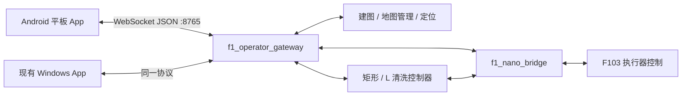

# 水面机器人 Android 平板操作端方案（历史）

> **历史设计资料，非当前功能清单。** 本文记录 2026-10-31 的 `feature/op` 审阅和首版计划。当前版本、构建及操作以 [README](README.md) 为准；稳定版差异见 [2026-11-09 审查记录](docs/DEVELOP_REVIEW_2026-11-09.md)，历次完成情况见 [CHANGELOG](docs/CHANGELOG.md)。
>
> v0.6.0 起已按上游取消雷达点、预期轨迹、起始范围框和停车点显示，改用压缩底图、实时船体与实际历史轨迹；原文对应图层和队列改进建议均属于当时方案。v0.7.0 基于 `develop` 核对，不能将本文的“未测试”“待实施”当作当前状态。

日期：2026-10-31。需求：约 11.5 英寸安卓平板，型号未定，完整覆盖现有 Windows App 已实现功能。

代码基线：`YYYKblue/surface_robot` 的 `feature/op`，提交 [`53692ef391fd22bf20ec5b51622ac3b7e92574d4`](https://github.com/YYYKblue/surface_robot/commit/53692ef391fd22bf20ec5b51622ac3b7e92574d4)。这是本次读取时的分支快照，后续开发需重新核对分支变化。

本文是代码审阅后的设计方案。Windows 功能基本测试正常来自用户反馈；本次未运行 ROS、Windows 或 Android 测试，未连接实船，未修改远程仓库或机器人工作空间。

## 1. 推荐架构与技术选择

采用原生 Kotlin + Jetpack Compose 开发独立 APK，通过现有 WebSocket 网关连接 Nano。定位、建图、任务状态机、执行器互斥及通信期限继续由机器人端负责。



两种客户端均可观察，但只允许一个活动控制端；图中双连接不表示允许同时驾驶。

推荐 Kotlin 的原因是本轮目标明确为 Android，触摸取消、窗口焦点、系统生命周期、网络权限及平板适配都需要认真处理。现有 Python/Qt 窗口代码用于迁移业务语义和测试样例，不直接复用为安卓 UI。地图数学转换、协议字段、中文状态文案、Mock 场景可以移植。

Qt for Python 官方确有 [Android 部署工具](https://doc.qt.io/qtforpython-6/deployment/index.html)，并非技术上不能移植；但当前 QWidget 风格窗口仍需进行平板交互改造。若未来需要重做 Windows 与 Android 共用客户端，可再评估 Qt Quick 或 Flutter；本次不为尚未提出的平台需求扩大工程。

建议组成：Compose/Material 3、自绘二维地图 Canvas、ViewModel + StateFlow、协程、OkHttp WebSocket、kotlinx.serialization、DataStore。这些是拟选技术，版本在搭建工程时按兼容矩阵锁定。首版无需本地 ROS、rosbridge、WebView、云端服务或在线地图 SDK；地图是项目自己的 OccupancyGrid，并非互联网街道地图。

## 2. 现有代码决定的功能边界

| 代码依据 | 已有能力或约束 | Android 处理 |
|---|---|---|
| [operator_app/README.md](https://github.com/YYYKblue/surface_robot/blob/53692ef391fd22bf20ec5b51622ac3b7e92574d4/operator_app/README.md) | 建图、选图、手动、任务、位姿和轨迹 | 全部纳入首版交付范围 |
| [protocol.py](https://github.com/YYYKblue/surface_robot/blob/53692ef391fd22bf20ec5b51622ac3b7e92574d4/src/f1_operator_gateway/operator_gateway/protocol.py) | `f1-operator-v1`；方向离散；PWM 档位仅 25/50/75 | 保留方向键及档位，不把摇杆任意浮点值送入协议 |
| [node.py](https://github.com/YYYKblue/surface_robot/blob/53692ef391fd22bf20ec5b51622ac3b7e92574d4/src/f1_operator_gateway/operator_gateway/node.py) | 网关管理控制租约；默认输入超时 0.25 s，命令 TTL 0.25 s，遥测默认 10 Hz | App 发送操作意图，不生成机器人控制 token；手动发送周期初定 50 ms |
| [task_control.py](https://github.com/YYYKblue/surface_robot/blob/53692ef391fd22bf20ec5b51622ac3b7e92574d4/src/f1_operator_gateway/operator_gateway/task_control.py) | 异步交接、请求编号去重、状态门控、结果待确认 | 不把发送成功当执行成功；不自动重放离散请求 |
| [runtime.py](https://github.com/YYYKblue/surface_robot/blob/53692ef391fd22bf20ec5b51622ac3b7e92574d4/src/f1_operator_gateway/operator_gateway/runtime.py) | 受管模式、建图保存、地图加载 | 使用受管入口，普通独立网关不足以提供全覆盖功能 |
| [map_canvas.py](https://github.com/YYYKblue/surface_robot/blob/53692ef391fd22bf20ec5b51622ac3b7e92574d4/operator_app/map_canvas.py) | 栅格、原点旋转、Y 翻转、轨迹分段 | 原样迁移坐标语义，新增触摸缩放和平移 |
| [window.py](https://github.com/YYYKblue/surface_robot/blob/53692ef391fd22bf20ec5b51622ac3b7e92574d4/operator_app/window.py) | 摄像头目前只是预留占位 | 视频不算已实现功能；本版不虚构视频链路 |

`speed_percent` 是 PWM 档位，不是实测航速。现有 ControlState 的 `target_pwm_bl_br_fl_fr` 是目标 PWM，也不是实际转速。没有找到已接入的机器人电池百分比或实时视频字段，不能在首版把它们显示成真实遥测。

## 3. 11.5 英寸界面设计

横屏作为主要操作姿态，按实际窗口 dp 尺寸布局，不把“11.5 英寸”等同于某个像素分辨率。建议主画面采用“左侧导航 + 中央地图 + 右侧操作面板”。

```text
┌─────────────────────────────────────────────────────────────┐
│ 机器人地址 / 连接新鲜度 / 当前控制端 / 定位 / 实际输出或预览    │
├──────┬────────────────────────────────┬──────────────────────┤
│ 作业 │                                │ 当前任务 / 手动控制   │
│ 建图 │ 地图、船头、雷达                │ 启动条件与阻塞原因    │
│ 地图 │ 清洗目标段、起始范围、历史轨迹  │ 当前阶段 / 覆盖结果   │
│ 诊断 │                                │ 明确标注的操作按钮    │
│ 设置 │ 缩放 / 回中 / 图层 / 设置位姿   │ 停止手动 / 停止任务   │
├──────┴────────────────────────────────┴──────────────────────┤
│ 船体中心距左墙 / 操作反馈 / 数据过期或历史轨迹提示             │
└─────────────────────────────────────────────────────────────┘
```

- 约 1200 dp 宽的设计参考：导航 72 dp、操作面板 320–360 dp，其余给地图；这是设计参考，不是设备规格。
- 840 dp 及以上可用宽度采用双面板；不足时将操作区折叠成独立页或面板，仍保留状态与停止入口。高度不足也要调整，不仅检查宽度。依据 [Android 窗口尺寸分类](https://developer.android.com/develop/ui/compose/layouts/adaptive/use-window-size-classes)。
- 普通控件触摸区域至少 48 dp；方向键建议 72–88 dp、停止按钮建议至少 64 dp 高，具体由真机握持测试调整。48 dp 基线参考 [Android 触摸目标建议](https://support.google.com/accessibility/android/answer/7101858?device=c&hl=en)。
- 默认高对比浅色主题；状态同时使用文字、图标和颜色。红色用于停止及故障，不能仅凭红绿判断是否可操作。
- 地图支持双指缩放、拖动、适配全图、船体回中和图层开关。设置位姿进入明确的编辑模式，选位置、拖船头方向、预览后发布；不能把普通地图拖动误认为定位操作。
- 任务侧显示当前阶段和具体阻塞原因；不显示无依据的整场倒计时、预计剩余时间或“全池已清洁”结论。

## 4. 首版全功能范围（历史）

当前显示图层已调整，以下为首版约定；最新范围见 README。

### 4.1 作业与手动控制

保留前进、后退、LEFT、RIGHT、停止，以及 FRONT/BOTH/BACK 轮组选择和 25/50/75 档位。左右方向在不同轮组下的实船效果应沿用现有行为并验收，不直接标成通用的“角速度摇杆”。

方向键按住运行、松开停止主驱动；滚刷和第五电推维持现有独立控制，范围 -100%～100%，第五电推必须受 `allow_fifth_thruster` 门控。界面说明“松开方向键仅停止主驱动”；停止手动输出则清空主驱动及两个辅助执行器的手动意图。

开始输入、打开键盘、离开驾驶页、窗口失焦、系统取消手势、退后台、锁屏或断线时，清空所有手动意图并尽力发送 `manual_stop`，随后停止手动续发。回到前台不自动恢复之前的运动或辅助开关。进程被强杀时不能依赖生命周期回调，机器人端超时仍是必要保障。

手动发送器与 UI 绘图解耦；只保留最新输入，禁止重放积压的方向。触摸正常抬起可立即发送新 STOP 输入；发生中断/取消则执行完整手动停止。协议库本身的发送队列也要监控，出现积压时结束控制并重连，不让旧运动排队送达。

### 4.2 自动清洗

完整支持 L / 矩形任务、设置初始位姿、定位稳定状态、开始/暂停/停止/取消、起始墙和参考范围、阶段与原因、预期与实际轨迹、左墙距离及任务结果。

必须保留的语义：

1. 定位就绪和启动条件以机器人端为准，App 不能靠本地等待一秒自行放行。
2. 暂停不支持断点继续；取消后才可重新开始。停止后再次开始是新任务、新 `run_id`。
3. `manual_stop` 不停止自动任务，两类停止入口要明确分开。软件请求处理成功也不意味着船体惯性漂移已结束。
4. 当前断线策略是停止手动会话，已启动的自动任务不因 App 断开而主动取消。界面须说明；若改成“平板失联自动暂停”，需要机器人端会话心跳和策略调整，属于另一个明确变更。
5. 当前 `COMPLETE` 表示本次路线执行结束；`coverage_complete` 和剩余接触区间单独显示。矩形绕行后只补起始边前段；L 从当前位置之后执行到终点，不返回补洗。
6. 最新靠近流程没有路径搜索或环境碰撞检查。地图目标段不能标为“已验证无碰撞路径”。

上述行为依据 [Windows App 说明](https://github.com/YYYKblue/surface_robot/blob/53692ef391fd22bf20ec5b51622ac3b7e92574d4/operator_app/README.md) 和 [当前清洗流程](https://github.com/YYYKblue/surface_robot/blob/53692ef391fd22bf20ec5b51622ac3b7e92574d4/docs/pool_cleaning/WALL_CLEANING_FLOW.md)。

### 4.3 建图与地图管理

完整支持开始建图、手动探索、保存快照继续、保存并结束、明确放弃、地图列表、独立预览、加载、导出失败重试和最终文件路径反馈。地图保存在 Nano 的 `workspace_root/maps/`，平板只缓存显示内容与连接设置。

独立预览不叠加当前机器人位姿；加载地图后重新设置初始位姿。保存成功不等于地图支持两种清洗路线；不可用任务需展示后端推导原因。重连后读取实际会话和最近保存结果，不自动补发保存请求。

### 4.4 诊断与连接

提供地址/端口配置、连接状态、控制端占用、控制源、输出许可、ACK/CTRL 数据年龄、定位阻塞原因、网关操作结果及本地诊断导出。首版手工填写 Nano 地址，不要求先做自动发现。

默认只在明确进入控制模式后发送手动输入，观察状态不持续发送 STOP 包抢占控制端。现有活动端身份与连接绑定：`manual_stop` 不释放活动客户端身份，断开才释放。首版可提供“释放操作权”并在清空手动输出后断开、重新连接为观察端；自动任务或离散请求未确认时不这样切换。

## 5. 通信与地图实现

保留协议名及能力协商：`task_selection/initial_pose/start_conditions/task_stop/task_tracks/mapping/map_catalog`。未知字段容忍、缺失关键能力禁用对应入口；未知阶段显示原始阶段及提示，不映射为任务成功。

| 操作 | 现有消息 |
|---|---|
| 握手 | `hello`，客户端名称建议 `f1-operator-android` |
| 手动 | `manual_input`：递增 seq、方向、档位、轮组、滚刷、第五电推 |
| 手动停止 | `manual_stop` |
| 任务 | `task`：task_type、action、request_id |
| 初始位姿 | `initial_pose`：x/y/yaw、当前 map_revision、request_id |
| 建图地图 | `mapping`：start/save/save_end/discard/list/preview/load/retry_export |
| 接收 | hello、map、telemetry、reply、error |

每次离散操作使用唯一 request_id；重连会改变服务端 client_id，现有去重不是跨连接持久幂等，不能在新连接上盲目重试旧操作。`pending=true` 表示待确认，包括 success 为 false 的超时反馈；应等待状态核对，不能显示“已停止”或断言操作未执行。

沿用 Windows 的 0.8 s 遥测过期界面规则，并同时遵守网关每个数据源的新鲜度标志。使用 Android 单调时间计算本地接收年龄，不直接用平板墙钟和 Nano 时间相减。遥测过期隐藏实时位姿/雷达和起始范围，历史轨迹可以保留，但标为历史。

地图处理：后台解析 OccupancyGrid，一次生成位图并按 revision 更新；雷达、船头和轨迹用矢量层叠加。地图原点 yaw、分辨率、屏幕 Y 翻转、缩放和平移统一走一套正反变换，初始位姿发布使用其逆变换。原始栅格坐标的单元中心使用 0.5 单元偏移；世界坐标的轨迹和雷达点不额外加偏移。

保持轨迹的分段、map_id/run_id 隔离和 truncated 提示。网关已将雷达点转换到 map，Android 不再重复做雷达安装角补偿，也不增加旧版固定 π 船头补偿。

地图 JSON 可能超过数 MB。网关 128 KiB 限制针对客户端发往网关的输入消息，并不是 App 接收地图的上限。Android 要分别约束地图尺寸、单条接收大小和解码内存；上限需在真实地图及候选平板上测定，不通过忽略大地图来实现兼容。

网络配置必须覆盖 `INTERNET` 和现有 `ws://` 明文局域网连接；采用受控的局域网部署配置，后续认证/WSS 单独协商，不用“信任所有证书”。参考 [Android 网络安全配置](https://developer.android.com/privacy-and-security/security-config)。面向 Android 17/API 37 及以上时需要处理局域网运行时权限，拒绝权限应给出明确状态，参考 [Android 局域网权限](https://developer.android.com/privacy-and-security/local-network-permission)。

## 6. ROS 工作空间是否需要修改（当时判断）

下表是原 `feature/op` 基线的建议，最新网关已加入压缩地图与有界流处理，不能据此推断 `develop` 仍存在全部旧问题。

结论：实现现有功能全覆盖，不要求先重写 ROS 或变更底层消息。先以当前协议完成 Android 功能对齐。全功能联调使用 `operator_system.launch.py` 受管入口，防止只启动独立网关而缺失建图/地图能力。

建议在 Android 开发中同步做以下小范围工程工作：

| 优先级 | 位置 | 拟工作与验收 |
|---|---|---|
| P0 文档/测试 | 新增协议文档及测试数据 | 固定所有消息、可空字段、能力和结果语义；生成脱敏真实报文和异常样例，让两端共用合同测试 |
| P0 验收 | gateway/test 与 Android 测试 | 断网、慢读、多端争用、启动后立即停止、保存超时、重连与旧地图包测试；确认现有保护在平板网络下成立 |
| P1 定向改进 | websocket_hub.py | 核查并改为每客户端有界发送队列；遥测/地图合并旧版本，reply 保证有序或明确断开失败；慢观察端不能积累无限发送任务 |
| P1 定向改进 | websocket_hub.py | 当前事件队列满时直接丢最旧项，并未按注释辨别生命周期与手动输入；增加事件分级，保护断连和离散命令，手动仅保留最新值；所有队列仍须有界 |
| P1 可选交互 | protocol.py、node.py | 若需要 Windows/Android 频繁切换，新增明确的获取/释放客户端操作权能力，区别于 bridge 租约；保留旧客户端兼容 |
| 按实测决定 | node.py 与客户端 | 大地图慢读测试若影响遥测时效，再协商压缩/分块/独立地图通道；不能直接取消旧 JSON 格式 |

队列问题依据 [websocket_hub.py](https://github.com/YYYKblue/surface_robot/blob/53692ef391fd22bf20ec5b51622ac3b7e92574d4/src/f1_operator_gateway/operator_gateway/websocket_hub.py) 的静态审阅；本次没有进行拥塞复现，不声称实机已经出现故障。

身份认证/WSS、统一软件停止命令、自动任务失联暂停、连续摇杆速度接口、视频均为后续能力，不能悄悄并入现有协议。尤其连续运动轴可能涉及网关、bridge 及固件能力，不仅是画一个摇杆。

## 7. 工程组织和实施顺序

建议 Android 项目独立放在本工作区，ROS 修改在原仓库单独形成可审查提交；协议文档标记兼容的仓库提交。Android 初期单 app 模块，按以下包组织即可，避免一开始拆大量 Gradle 模块：

```text
app/
  protocol/       DTO、编解码、capability 与兼容性
  connection/     WebSocket、重连、命令队列、接收新鲜度
  state/          机器人状态、手动意图、请求结果归约
  map/            栅格缓存、坐标转换、图层、触摸交互
  feature/        作业、建图、地图库、诊断、设置
  mock/           不连接硬件的模拟网关与故障场景
```

完整范围不删减，按以下顺序交付以便逐步联调：

1. 协议与可交互 Mock：横屏布局、连接、地图、全状态展示；验收明确标注模拟，不连接硬件。
2. 实网关只读链路与手动控制：验证坐标、接收负载、单活动端、输入取消及超时；先禁用硬件输出。
3. 自动任务全流程：初始位姿、定位门控、任务互斥、开始/暂停/停止/取消、轨迹和覆盖结果；用模拟 ROS 服务覆盖异常时序。
4. 建图地图全流程：快照、保存结束、放弃、列表预览加载、失败重试、重连恢复显示；先以合成扫描测试。
5. 候选平板实机验收、与 Windows 回归、签名 APK 和部署说明。实际运动与建图效果单独现场验收。

未确定平板、开发投入和现场条件，当前不承诺固定工期。最终交付至少包括完整功能 APK、Android 源码、协议说明、测试记录，以及确有必要时的 ROS 补丁。

## 8. 验收清单

- 功能：逐项对照本文件全功能范围；旧网关缺少能力时正确禁用，未知字段不导致崩溃。
- 坐标：与 RViz/Windows 对照非零地图原点、旋转地图、同一点、同一船头方向、缩放后的位姿发布和雷达重叠。
- 操作：抬指、滑出、系统取消、第二根手指干扰、失焦、键盘、分屏、锁屏、后台、进程终止、Wi-Fi 切换均不会自动恢复旧运动。
- 时序：开始未返回即停止/取消；响应丢失；服务超时但稍后执行；网关重启；连接已恢复但没有新遥测；旧 map/run_id 消息不得覆盖新状态。
- 多端：Windows 占用时平板只读；平板释放后 Windows 可控制；两个观察端不能影响活动控制端。
- 地图：至少覆盖仓库文档提及的 1054×863 栅格规模，再根据实际地图加测更大数据；保存失败不能显示成功或自动退出建图。
- 性能：记录真机绘图帧时间、内存、CPU、网关队列、网络吞吐及延迟分布；地图更新期间验证手动输入和停止处理。60 fps 为界面目标而非验收前的事实，遥测仍按实际 10 Hz 数据更新。
- 停止：分别测量触摸释放到停止请求、机器人输出归零时间、船体物理停止距离。0.25 s 是软件参数，不是已验证的整船停止时间。
- 结果：路线结束、覆盖记录、定位有效性、输出许可分别呈现；禁止 Mock、preview 与实际硬件结果混淆。

平板型号确定后补齐 Android 版本、分辨率/逻辑密度、CPU/内存、Wi-Fi 条件、户外亮度与防水使用方式；先用候选真机做上述接收负载与生命周期验收，再确定最低支持设备。
